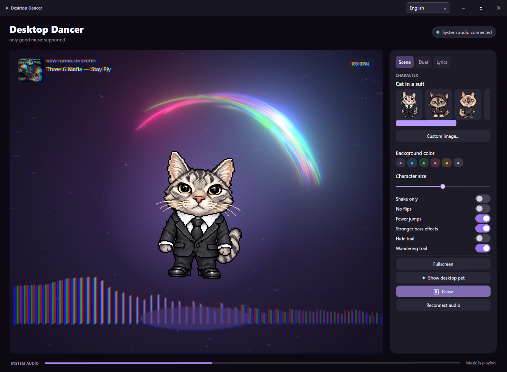
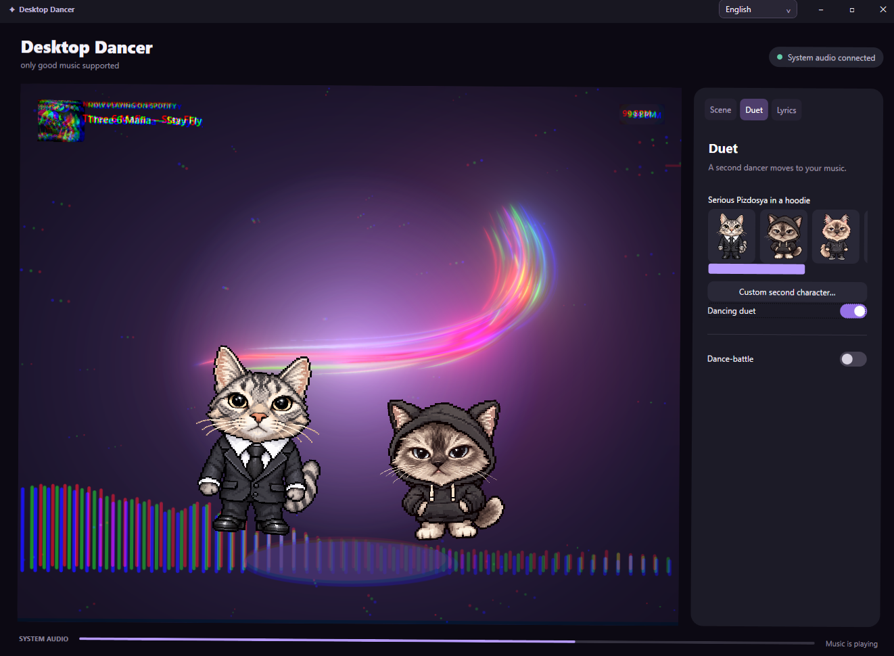
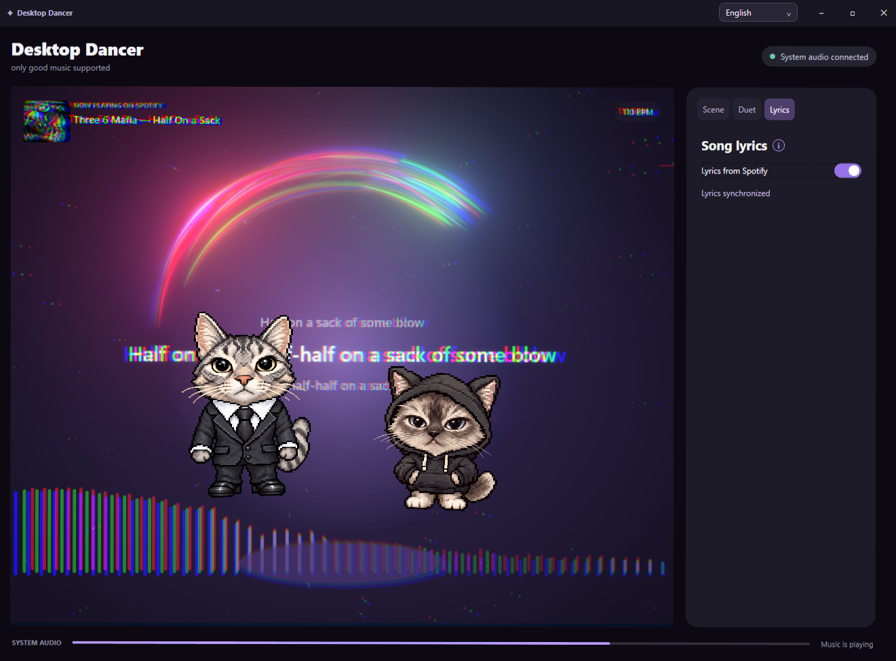

# Desktop Dancer 1.0

**[Русский](README.ru.md) · English**

A Windows desktop companion that dances to your system audio. Pick a character, watch the equalizer and bass effects, or bring a dancing pet onto your desktop.

## Download and run

1. Download **DesktopDancer-1.0-win-x64.zip** from [Releases](https://github.com/hlebbbka/Desktop-Dancer/releases/latest).
2. Extract the entire archive and run **Start.cmd**.
3. Play music on your default Windows playback device.

Windows 10/11 x64 is required. The release includes .NET; install [Microsoft Edge WebView2 Runtime](https://developer.microsoft.com/microsoft-edge/webview2/) if it is missing. Keep the `app` and image folders next to the launcher.

## In action

### Solo dance, equalizer and wandering trail



### Duet



### Song lyrics — Spotify only

**This lyrics mode works only with Spotify.** Open the lyrics panel in the Spotify desktop app and keep its window unminimized.



## Features

- System audio capture: works with Spotify and other music apps.
- Five included characters, custom images and an independent second character.
- Duets and Dance-battle: dancers take turns every four beats and finish their current move before handing over.
- Bass-driven jumps, flips, glow, scene motion and chromatic aberration.
- A wandering trail that accelerates on bass hits and stays faster during sustained bass, plus a mouse-controlled trail mode.
- Desktop pet, fullscreen scene, background themes and character size adjustment.
- Estimated BPM, Spotify track title and album artwork.
- Spotify lyrics in windowed mode. Open Spotify's lyrics panel and keep its window unminimized; enable **Lyrics from Spotify**. Lyrics are hidden in fullscreen.
- Instant **Russian / English** selection in the top-right corner. Language and preferences are saved locally.

Rendering targets 140 FPS; actual performance depends on your display, GPU and system load. Effects pause when the application is minimized.

## Build from source

Install the [.NET 8 SDK](https://dotnet.microsoft.com/download/dotnet/8.0) on Windows x64. The referenced WebView2 and Windows SDK assemblies are included with their third-party notices.

```powershell
dotnet build MusicDancer -c Release
dotnet run --project MusicDancerChecks -c Release
powershell -ExecutionPolicy Bypass -File scripts/Build.ps1
```

The packaged application and ZIP are created in `dist/`. To produce a smaller package requiring .NET Desktop Runtime 8, add `-FrameworkDependent` to the build script. Optional trail checks: `node MusicDancer/Diagnostics/check-wandering.mjs`.

Preferences are stored in `%LOCALAPPDATA%\Tanctspol\settings.json`. Audio is analyzed locally. Spotify metadata uses Windows media sessions; lyrics are read from Spotify's visible lyrics interface without an API key.

## Credits

The trail is adapted from **Tubes Cursor** by Kevin Levron / soju22. See [third-party notices](THIRD_PARTY_NOTICES.md) and [the detailed attribution](MusicDancer/Web/ATTRIBUTION.txt) for component licenses and modifications.
