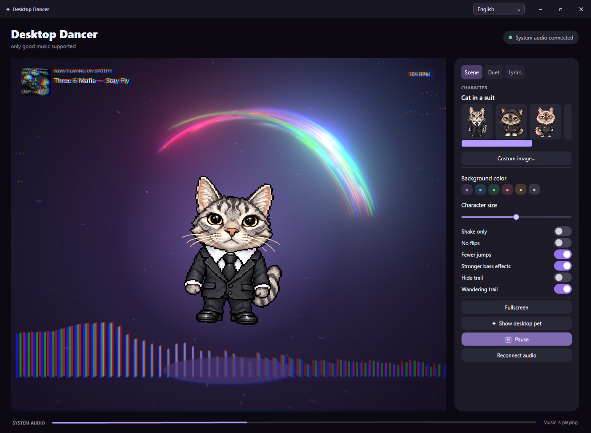
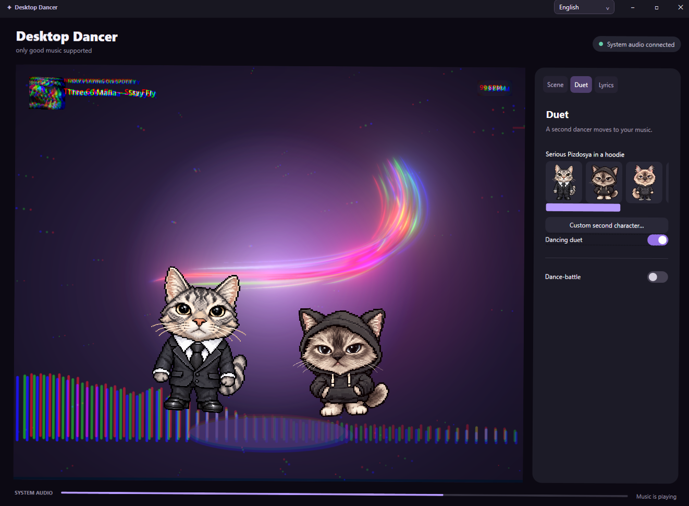
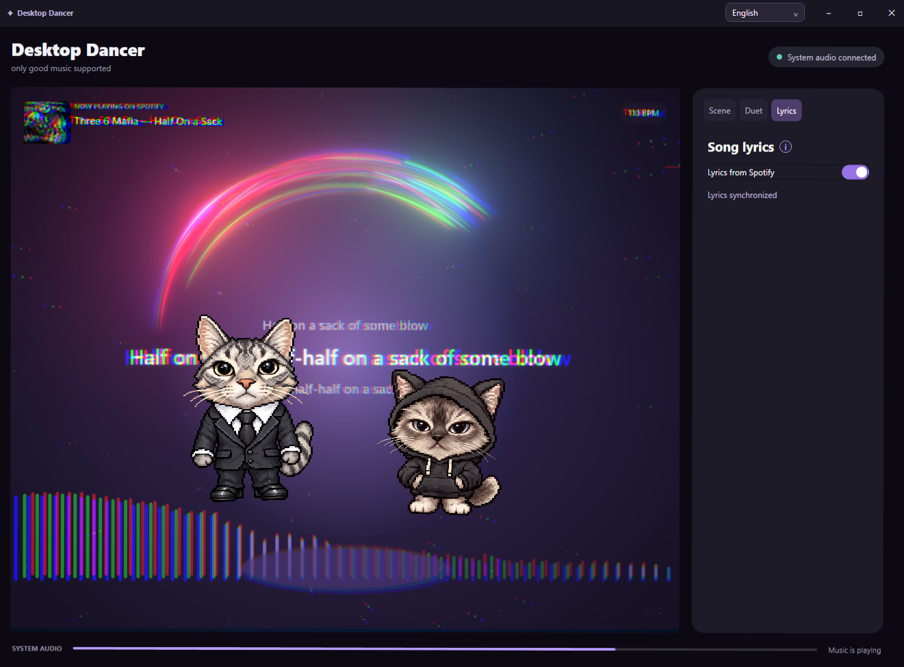
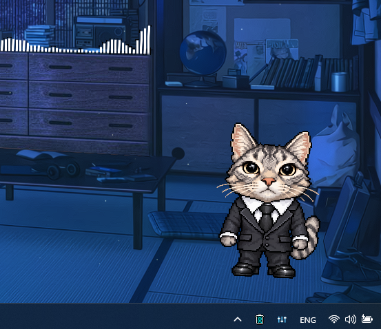

# Desktop Dancer 1.0

**Русский · [English](README.md)**

Приложение для Windows, в котором персонажи танцуют под системный звук. Выбирайте персонажа, наблюдайте за эквалайзером и эффектами басса или выводите танцующего питомца на рабочий стол.

## Скачать и запустить

1. Скачайте **DesktopDancer-1.0-win-x64.zip** из раздела [Releases](https://github.com/hlebbbka/Desktop-Dancer/releases/latest).
2. Распакуйте архив целиком и запустите **Start.cmd**.
3. Включите музыку на устройстве воспроизведения Windows по умолчанию.

Нужна Windows 10/11 x64. Среда .NET включена в релиз. Если отсутствует [Microsoft Edge WebView2 Runtime](https://developer.microsoft.com/microsoft-edge/webview2/), установите его отдельно. Папки `app` и изображений должны оставаться рядом с файлом запуска.

## Как это выглядит

### Сольный танец, эквалайзер и гуляющий шлейф



### Дуэт



### Текст песни — только Spotify

**Режим текста песни работает только со Spotify.** Откройте панель текста в приложении Spotify на компьютере и не сворачивайте его окно.



### Питомец на рабочем столе



## Возможности

- Захват системного звука: музыка из Spotify и других приложений.
- Пять встроенных персонажей, свои изображения и независимый выбор второго танцора.
- Дуэт и Dance-battle: смена танцора каждые четыре доли с завершением текущего движения.
- Прыжки, сальто, свечение, покачивание сцены и хроматическая аберрация от басса.
- Гуляющий шлейф ускоряется на ударах и сохраняет ускорение во время продолжительного басса. Есть режим управления шлейфом мышью.
- Питомец на рабочем столе, полный экран, цветовые темы и изменение размера персонажа.
- Определение BPM, название трека и обложка из Spotify.
- Текст из Spotify в оконном режиме. Откройте панель текста в Spotify, не сворачивайте его окно и включите **Текст из Spotify**. В полном экране текст скрыт.
- Мгновенный выбор **Русский / English** справа сверху. Язык и настройки сохраняются локально.

Целевая частота отрисовки — 140 FPS; результат зависит от монитора, видеокарты и нагрузки системы. При сворачивании приложения эффекты приостанавливаются.

## Сборка из исходников

Установите [.NET 8 SDK](https://dotnet.microsoft.com/download/dotnet/8.0) на Windows x64. Используемые сборки WebView2 и Windows SDK включены в репозиторий вместе с уведомлениями о сторонних компонентах.

```powershell
dotnet build MusicDancer -c Release
dotnet run --project MusicDancerChecks -c Release
powershell -ExecutionPolicy Bypass -File scripts/Build.ps1
```

Приложение и ZIP появятся в папке `dist/`. Для меньшего архива, требующего установленную .NET Desktop Runtime 8, добавьте параметр `-FrameworkDependent`. Дополнительная проверка шлейфа: `node MusicDancer/Diagnostics/check-wandering.mjs`.

Настройки: `%LOCALAPPDATA%\Tanctspol\settings.json`. Звук анализируется локально. Данные трека берутся из медиасессий Windows, а текст — из интерфейса Spotify без API-ключа.

## Благодарности

Шлейф создан на основе **Tubes Cursor**, автор Kevin Levron / soju22. Лицензии компонентов и изменения описаны в [уведомлениях](THIRD_PARTY_NOTICES.md) и [подробной атрибуции](MusicDancer/Web/ATTRIBUTION.txt).
